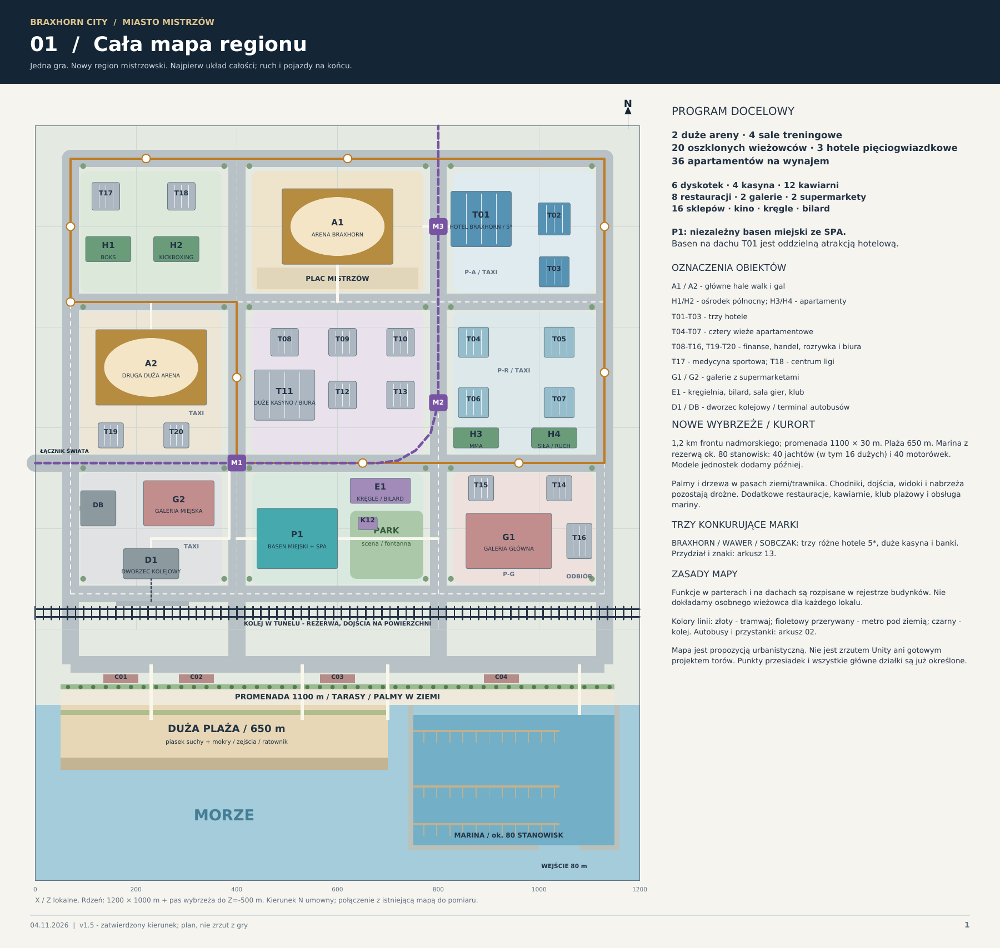
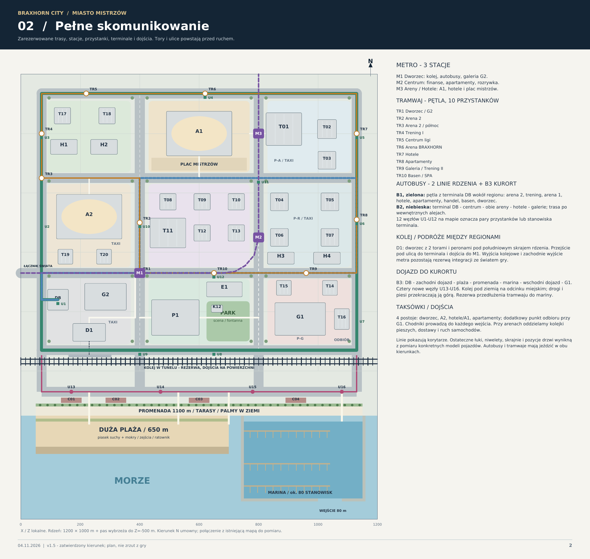
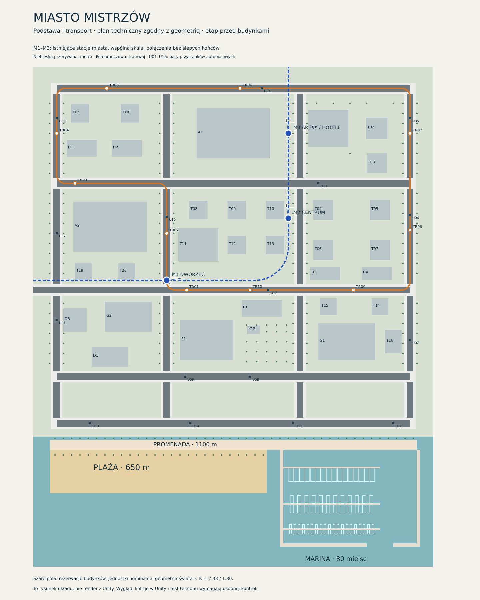

# Miasto Mistrzów — mapa i przekazanie prac

**Aktualizacja po APK #4:** [diagnoza i naprawy runu 41907419292](mistrzowie-audyt-run4-20261104.md). Run na `c30e305` zatrzymał się na kolizji trasy metra przed generowaniem Patryka i kompilacją APK. Poprawiono trasę, obudowę pod schodami, obrót źródłowego pociągu oraz import tekstur; kontrole statyczne przeszły. Nowa kompilacja Unity i test Androida pozostają niewykonane. Poniższy plan i wcześniejsze statusy są zachowane jako historia zakresu.

Stan na 4 listopada 2026 r. Region tej samej gry **BRAXHORN CITY**, projekt `unity-city`, Unity **6000.0.58f2**, Built-in Render Pipeline. Gałąź robocza: `codex/miasto-mistrzow-20261104`. Odczytany kod: `47c89f05796c675d02a15982382a37ef4c5d20be`.

**Najpierw przeczytaj ten dokument, potem mapy. Plan docelowy, kod generatorów i działająca gra to różne stany. Pierwszy przebieg APK zakończył się przed uruchomieniem Unity.**

## Mapy i pełny plan

| Plik | Co pokazuje | Jak używać |
|---|---|---|
| [Pełny plan PDF — 14 stron](Braxhorn_Miasto_Mistrzow_Mapa_i_Plan_v1.pdf) | Miasto, komunikacja, program budynków, kurort, standard i trzy marki | Oryginalny plan bez przeróbek. Wewnątrz oznaczony v1.5; nazwa pliku pozostała v1. |
| [Mapa miasta PNG](mistrzowie-plan-miasta.png) | Strona 1 tego samego PDF | Czytelny podgląd planu na GitHub i telefonie. |
| [Mapa komunikacji PNG](mistrzowie-plan-komunikacji.png) | Strona 2 PDF: metro, tramwaj, autobusy, kolej i kurort | Przebiegi koncepcyjne; współrzędne wykonawcze sprawdź poniżej. |
| [Aktualny rzut podstawy SVG](mistrzowie-podstawa.svg) | Układ generatora: skorygowane metro, tramwaj, przystanki, nasadzenia, A1/T01 i rezerwy | Źródło orientacji w obecnej implementacji; nie jest renderem z Unity. |
| [Opis techniczny podstawy](MIASTO-MISTRZOW-PODSTAWA.md) | Ponowne użycie metra i areny, skala, sceny, źródła | Szczegóły integracji; aktualizacje statusu w tym przekazaniu. |
| [Patryk — wygląd, ruch, sterowanie](mistrzowie-patryk-naprawa-20261104.md) | Oryginalne mapy 4K, przeniesione sterowanie i poprawki animacji | Wymagany odbiór wyglądu i biegu na urządzeniu. |

PDF skopiowano bajt w bajt z planu właściciela. SHA-256: `819dc8ff790181261955f983c2ded337d3583a2f9a1ed3b6c2349e3125d503ea`. Obrazy PNG są renderami dwóch pierwszych stron. Nie zmieniono układu ani wizji pod pozorem przygotowania dokumentacji.

## Co mamy zrobić

To najważniejszy, ekskluzywny region kariery: najlepsi zawodnicy przyjeżdżają walczyć o pas. Realistyczna architektura, szkło, kamień, metal, pełny detal ulicy i wiarygodna zieleń. Teraz powstają teren, infrastruktura i wykończone zewnętrza. Wnętrza usług i ruch pojazdów są późniejszymi etapami.

| Zakres docelowy | Obiekty / ustalenie |
|---|---|
| 2 duże areny | A1 BRAXHORN CHAMPION ARENA — PÓŁNOC; A2 CHAMPION ARENA — POŁUDNIE. A2 leży na południowy zachód od A1. Obie co najmniej w skali areny osiedla. |
| 4 sale w 2 miejscach | H1 boks + H2 kickboxing na północnym zachodzie; H3 MMA + H4 siła/ruch przy apartamentach na południowym wschodzie. Nie rozrzucać ich w czterech osobnych ośrodkach. |
| 20 wież T01–T20 | W tej liczbie 3 hotele pięciogwiazdkowe T01–T03 i 4 wieże apartamentowe T04–T07, razem 36 lokali najmu. Wysokości planu 80–180 m nominalnych. |
| Hotele i banki | BRAXHORN: hotel T01, bank T15; WAWER: hotel T02, bank T08; SOBCZAK: hotel T03, bank T09. |
| Kasyna | 4 w planie: duże C1/WAWER w T11 i C2/BRAXHORN w T01; dodatkowe C3/SOBCZAK w T10 i C4/BRAXHORN w T20. Minimum wymagane przez właściciela: 2 duże. |
| Handel i rozrywka | G1/G2: 2 galerie, 2 supermarkety, 16 sklepów; kino w G1. 6 klubów: T12, T13, T14, G2, dach T02, E1. E1 także kręgle, bilard i sala gier. |
| Gastronomia i usługi | 12 kawiarni i 8 restauracji przypisanych w PDF; medycyna sportowa T17, centrum ligi T18, usługi i finanse. Partery mają funkcję, wejście i zaplecze. |
| Publiczny basen | P1: samodzielny kompleks basenowy ze SPA, szatniami i zapleczem. Basen na dachu hotelu T01 jest osobnym dodatkiem. |
| Całe południowe wybrzeże | Promenada 1100 × 30 m, plaża długości 650 m, morze, marina z rezerwą 80 stanowisk: 40 jachtów, w tym 16 dużych, i 40 motorówek. Docelowo co najmniej 15 jachtów plus motorówki; modeli jednostek jeszcze nie wstawiono. |
| Zieleń | Palmy i drzewa z potwierdzonych zasobów. Pasy ziemi/trawnika przy ulicach i promenadzie, rabaty przy plaży. Pnie poza chodnikami, przejściami, wejściami i pomostami. |

Trzy marki mają własne znaki: BRAXHORN — byk; WAWER — kruk; SOBCZAK — S w owalu. Szyldy: przestrzenne, fazowane litery, prawdziwe mocowania i kontrolowane podświetlenie; kompozycje łukowe, owalne i otwarte. Zachować zaakceptowane wzory właściciela. Rzeźbione modele byka i kruka wymagają potwierdzonego źródła; bazowe liternictwo generatora nie jest deklarowane jako odwzorowanie wzorów 1:1.

## Skala, teren i źródła współrzędnych

Rdzeń: **X=0…1200, Z=0…1000** nominalnych metrów. Pas wybrzeża do **Z=−500**. Na rzutach północ to **+Z**, wschód **+X**, pion w Unity to **Y**. Osadzenie regionu w globalnym świecie nadal wymaga uzgodnienia; nie zgadywać przesunięcia względem miasta/osiedla/obozu.

Wspólna skala: **K=2,33/1,80 ≈ 1,29444**. Wymiary nominalne × K dają jednostki świata. Model 1,80 m nominalnie ma 2,33 jednostki świata. Geometria przeniesionej stacji metra jest już przeliczona: jej korzeń pozostaje `(1,1,1)`; bez drugiego mnożenia przez K.

Źródła wykonawcze:

- [layout.py](../../unity-tools/mistrzowie/layout.py): osie dróg, przystanki, stacje, otwory wejść i dojścia.
- [plan_inventory.json](../../unity-tools/mistrzowie/plan_inventory.json): pozycje i rezerwy **budynków**. Tablice transportu w tym pliku pochodzą ze starszego planu; do implementacji transportu używać `layout.py` i wygenerowanego `Transit.json`.
- [build_infrastructure.py](../../unity-tools/mistrzowie/build_infrastructure.py): geometria łączników, torów, chodników i przystanków.
- [arena-source.json](../../unity-tools/mistrzowie/arena-source.json): pochodzenie i wymiary adaptacji areny osiedla.

Osie ulic w kodzie: **X = 70, 400, 800, 1130**; **Z = −70, 70, 330, 650, 935**. Łącznik świata pozostaje rezerwą integracji. Drzwi, łuki transportu, skrajnie, przystanki i ruch należy mierzyć na rzeczywistych modelach wspólnej gry.

### Metro i transport

| Stacja | Środek peronu `(X,Z)` nominalnie | Oś | Obsługa |
|---|---:|---|---|
| M1 DWORZEC | 400, 359 | wschód–zachód | Dworzec, terminal, G2 |
| M2 CENTRUM | 765, 545 | południe–północ | Finanse, apartamenty, rozrywka |
| M3 ARENY / HOTELE | 765, 800 | południe–północ | A1, hotele, plac mistrzów |

Przenoszone są kompletne istniejące stacje miasta: schody, zadaszenia, wyposażenie, bramki, perony i tunele. Trasa łączy wszystkie trzy punkty dwoma torami; jej nominalny korytarz biegnie od `(0,359)` do `(765,359)`, następnie do `(765,1000)`, z łukiem. Przesunięcia stacji względem PDF wynikają z dopasowania prawdziwych wejść i tuneli. Nie przywracać dawnych znaczników PDF bez kontroli kolizji.

Tramwaj: zamknięta pętla, dwa tory, 10 przystanków TR01–TR10. Autobusy: 16 par U01–U16, czyli 32 stanowiska; B1 to pętla rdzenia, B2 obsługa centrum/aren/hoteli/galerii, B3 dojazd do kurortu z U13–U16. PDF pokazuje program tras autobusowych; nie oznacza wdrożonego ruchu, rozkładów ani wsiadania. Kolej D1 i jej odcinek podziemny oraz połączenia między regionami nadal są rezerwą planu. Taksówki i wszystkie regularne kursy uruchamiamy na końcu.

## Stan wykonania i rozbieżności do sprawdzenia

| Element | Potwierdzony stan | Czego nie wolno deklarować |
|---|---|---|
| Teren, ulice, wybrzeże, infrastruktura | Źródła geometrii i generator Unity w repo; istnieją wyniki wcześniejszych kontroli statycznych | Gotowego, odebranego spaceru po działającej scenie |
| Metro | Kod ponownego użycia 3 stacji i połączeń, otwory w gruncie oraz procedury kontroli przejść | Sprawdzonej w Unity jazdy, wejść, bramek ani zgodności kolizji |
| A1 i T01 | Kod pierwszych elewacji; adaptacja widowni A1 i basen hotelu na dachu | Ukończenia wszystkich budynków lub odbioru jakości premium |
| A2, pozostałe wieże, P1, galerie i usługi | Rezerwacje i program docelowy | Gotowych hal i działających usług |
| Patryk | Oryginalny FBX/Color/Normal; ORM 4K bez utraty texeli, poprawki retargetingu, istniejące sterowanie | Potwierdzonego poprawnego biegu i wyglądu na Androidzie |
| Szyldy | Źródła geometrii, katalog i początkowe zastosowanie w A1/T01 | Przyjęcia przez właściciela wszystkich znaków i fasad |
| Ruch i integracja | Rezerwy oraz dane transportu | Działających kursów, ekonomii, wspólnego zapisu i streamingu sektorów |

**Arena — jawna różnica plan/kod:** PDF proponuje halę 220 × 150 m oraz większe przedpole działki. Aktualna A1 ma bryłę **192 × 118 × 48 m**, widownię/salę **120 × 70 × 28 m**, a rezerwacja w `plan_inventory.json` wynosi 220 × 150 m. Wysokość 48 m nie jest szerokością. Arena osiedla w odczytanym źródle miała około 40 × 30 × 7 m. Kod jest od niej większy, ale nie realizuje dosłownie wymiaru hali z PDF. Przed dalszą zabudową sprawdzić przedpole, układ sektorów i dojścia. Cele 15 000/8 000 widzów z PDF są programem, nie zmierzoną liczbą siedzisk lub wydajnością tłumu.

Plan 24 sektorów i wczytywania wnętrz przy wejściu pozostaje kierunkiem integracji. Obecna scena eksploracyjna nie jest dowodem działającego streamingu. Zachować GUID/.meta; po pierwszym sprawdzonym eksporcie pracować na zapisanej scenie, bez nadpisywania ręcznych zmian generatorem.

## Jakość i odbiór prac

Źródła: repozytorium, własne zasoby właściciela, Poly Haven. Każdy brak zgłosić konkretnie po sprawdzeniu biblioteki. Brak zamienników obniżających jakość. Zachować oryginalne mapy i sprawdzać hash; rozdzielczość nie zastępuje poprawnego materiału. Istniejący pociąg ma źródła 1K — nie nazywać ich 4K i nie powiększać sztucznie.

Każdy budynek z zewnątrz obejmuje cztery elewacje, dach, wejście, ramy szklenia, głębię parteru, cokół, obróbki, odwodnienie, oświetlenie i najbliższy chodnik/zieleń. Fasady: co najmniej 8 sylwetek i 4 rodziny; dopuszczalne wspólne moduły, bez szeregu identycznych wież. Chodniki: właściwa skala płyt, fugi, krawężniki, obniżenia, odpływy, zero nakładających się powierzchni.

Patryk ma zachować twarz, sylwetkę, ubranie i kolory oryginału. Nie naprawiać ruchu przez zmianę modelu. Android: dotychczasowy joystick i kamera z `BraxGymPlayer`/`BraxTouchControls`. Scena `Mistrzowie_Explore` uruchamiana samodzielnie, z jednym graczem i jedną kamerą; bez jednoczesnego wczytywania Foundation z drugą kopią świata.

Odbiór wymaga ujęć z poziomu gracza, dzień/noc, zbliżeń materiałów, spaceru do wszystkich trzech wejść metra oraz filmu Idle → Walk → Run → Idle z przodu, boku i tyłu. Osobno mierzyć FPS, pamięć, czas wejścia i przejścia między strefami. Raportować kod, kompilację, dostawę APK i test telefonu oddzielnie.

## Workflow i aktualny błąd buildu

Osobny wpis [Miasto Mistrzów — APK](https://github.com/wawerpatryk89-sketch/braxhorn-city/actions/workflows/mistrzowie-apk.yml) został zarejestrowany na `main` przez PR #17. Formularz może pozostać na `main`: pole `commit` wskazuje wersję **kodu gry**, odrębną od commita workflow. Domyślny kod: `47c89f0…`; commit workflow pierwszego uruchomienia: `46309b5…`.

**Przebieg #1: FAILED przed Unity.** [Run 41885950373](https://github.com/wawerpatryk89-sketch/braxhorn-city/actions/runs/41885950373), job `126770341262`, 4 listopada 2026, około 19:19 czasu szwajcarskiego. Checkout właściwego kodu i 17 testów Python przeszły. Krok `Geometry and source preparation` zakończył się w `prepare_assets.py:33` błędem `KeyError: 'rough'` podczas odczytu metadanych Poly Haven. Log nie podawał identyfikatora materiału. Późniejszy odczyt wszystkich 11 odpowiedzi API potwierdził klucz `Rough` zamiast `rough`, już dla pierwszego `coast_sand_02`, oraz odrębny kolor `col_01` materiału `fabric_pattern_05`. Podpisywanie, Unity oraz zapis APK zostały pominięte. Nie ma dostarczonego APK.

Na polecenie właściciela poprawiono wybór `Rough`/`rough` i jawnie przypisano kolor `col_01` tkaniny, zgodny z domyślnym pakietem blend/glTF dostawcy. Mapy zachowują 4K, normalne GL i roughness EXR. Dodano kontrolę rozmiaru/checksum pobrania oraz błąd z nazwą materiału. Przeszły 23 testy łącznie, w tym 6 nowych testów regresji. Rozwiązano 33 mapy Poly Haven z 11 rzeczywistych odpowiedzi API, a pełny skrypt pobrał i sprawdził 43 mapy razem z potwierdzonymi paczkami właściciela. Wszystkie 43 pliki mają rzeczywisty wymiar 4096 × 4096 i zgodne sumy; nie były przeskalowywane. Pełną kontrolę pobrań opisuje [raport Poly Haven](mistrzowie-polyhaven-preflight-20261104.json). Wynik naprawionej kompilacji Unity pozostaje niepotwierdzony.

Obowiązują zasady [AGENTS.md](../../AGENTS.md): zapis kodu i dokumentacji nie uruchamia Unity. Kolejny build wymaga decyzji właściciela; brak automatycznych ponowień. Po udanym zbudowaniu APK najpierw potwierdzona dostawa pliku, potem dodatkowe raporty.

## Następny wykonawca

1. Przeczytaj to przekazanie, mapę SVG i pełny PDF; zachowaj układ i standard właściciela.
2. Sprawdź aktualny SHA i status workflow. Najpierw usuń potwierdzony błąd przygotowania materiałów w zakresie zleconej naprawy.
3. W zatwierdzonym przebiegu Unity sprawdź źródła, skalę, trzy stacje i przejścia; dopiero potem oceniaj A1/T01 oraz Patryka.
4. Oddaj materiał do oceny wizualnej; dopiero przyjęty standard rozwiń na A2, pozostałe fasady i kurort. H1/H2 oraz H3/H4 pozostają dwoma ośrodkami.
5. Wnętrza, usługi, integracja kariery, sektory i ruch pojazdów realizuj jako kolejne uzgodnione etapy tej samej gry.

## Rejestr położeń budynków

Poniższa tabela jest odczytem `plan_inventory.json`; **rezerwa nie oznacza gotowego budynku**. Wymiary i wysokości podano nominalnie, przed K.

| ID | Funkcja | X | Z | Rezerwa W × D [m] | Wysokość [m] |
|---|---|---:|---:|---:|---:|
| A1 | BRAXHORN CHAMPION ARENA — PÓŁNOC | 600 | 800 | 220 × 150 | 48 |
| A2 | CHAMPION ARENA — POŁUDNIE | 230 | 520 | 220 × 150 | 38 |
| H1 | BOKS | 145 | 755 | 90 × 50 | 12 |
| H2 | KICKBOXING | 280 | 755 | 90 × 50 | 12 |
| H3 | MMA | 875 | 380 | 90 × 40 | 12 |
| H4 | SIŁA / RUCH | 1030 | 380 | 90 × 40 | 12 |
| P1 | BASEN MIEJSKI + SPA | 520 | 180 | 160 × 120 | 16 |
| G1 | GALERIA GŁÓWNA | 940 | 175 | 170 × 110 | 24 |
| G2 | GALERIA MIEJSKA | 285 | 250 | 140 × 90 | 18 |
| E1 | KRĘGLE / BILARD | 685 | 275 | 120 × 50 | 15 |
| D1 | DWORZEC KOLEJOWY | 230 | 130 | 110 × 60 | 16 |
| DB | TERMINAL AUTOBUSÓW | 125 | 240 | 70 × 70 | 12 |
| K12 | KAWIARNIA PARKOWA | 660 | 210 | 38 × 25 | 5 |
| T01 | HOTEL BRAXHORN / 5* | 885 | 815 | 120 × 110 | 150 |
| T02 | HOTEL WAWER / 5* | 1030 | 815 | 64 × 64 | 130 |
| T03 | HOTEL SOBCZAK / 5* | 1030 | 710 | 60 × 60 | 110 |
| T04 | APARTAMENTY 1 | 870 | 570 | 60 × 60 | 120 |
| T05 | APARTAMENTY 2 | 1040 | 570 | 60 × 60 | 135 |
| T06 | APARTAMENTY 3 | 870 | 450 | 60 × 60 | 110 |
| T07 | APARTAMENTY 4 | 1040 | 450 | 60 × 60 | 150 |
| T08 | BANK / BIURA | 495 | 570 | 55 × 55 | 180 |
| T09 | FINANSE / BIURA | 610 | 570 | 55 × 55 | 160 |
| T10 | MEDIA / KASYNO | 725 | 570 | 55 × 55 | 145 |
| T11 | DUŻE KASYNO / BIURA | 495 | 465 | 120 × 100 | 120 |
| T12 | KLUB / BIURA | 610 | 465 | 55 × 55 | 140 |
| T13 | USŁUGI / KLUB | 725 | 465 | 55 × 55 | 155 |
| T14 | KLUB / BIURA | 1040 | 280 | 50 × 50 | 135 |
| T15 | HANDEL / BIURA | 885 | 280 | 50 × 50 | 95 |
| T16 | RESTAURACJA / BIURA | 1080 | 175 | 50 × 70 | 100 |
| T17 | MEDYCYNA SPORTOWA | 140 | 860 | 55 × 55 | 80 |
| T18 | CENTRUM LIGI | 290 | 860 | 55 × 55 | 105 |
| T19 | BIURA / USŁUGI | 150 | 385 | 50 × 50 | 90 |
| T20 | KASYNO / BIURA | 280 | 385 | 50 × 50 | 115 |

