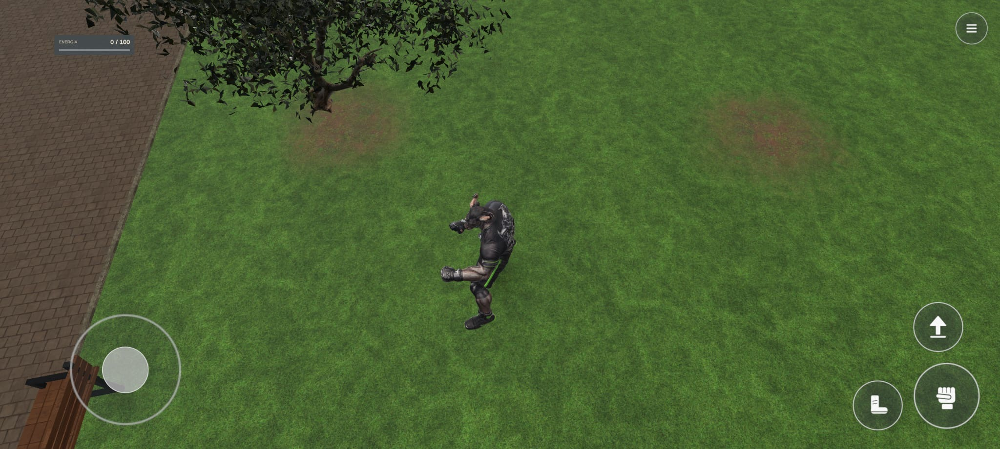
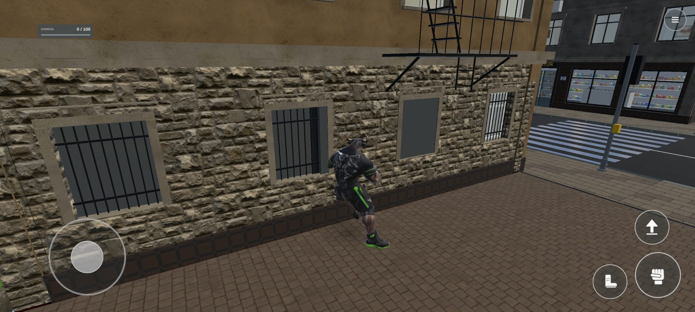
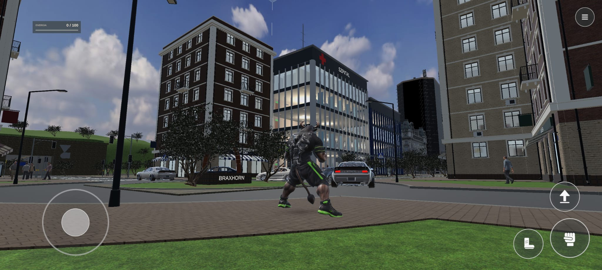
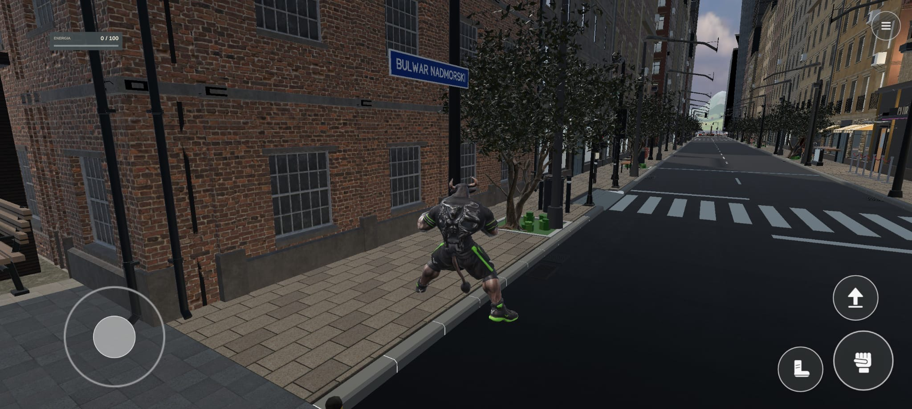
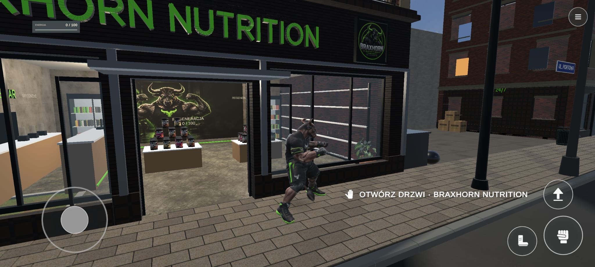
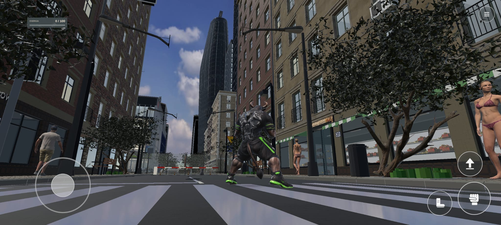

# Miasto Mistrzów — zdjęcia odniesienia i wymagany poziom jakości

Polecenie właściciela z 4 listopada 2026: **Miasto Mistrzów ma wyglądać wyraźnie lepiej niż jego pierwsze miasto pokazane na sześciu zdjęciach poniżej.** Wymagane są większy detal, lepsze tekstury, cienie i oświetlenie. Charakter regionu: luksusowe miasto bogaczy, zgodne z już zatwierdzonym projektem.

Właściciel doprecyzował: **„Tak jak jest w projekcie”.** Obowiązuje [oryginalny plan PDF](../Braxhorn_Miasto_Mistrzow_Mapa_i_Plan_v1.pdf), [mapa i przekazanie](../MIASTO-MISTRZOW-START.md) oraz [wspólny standard Unity 6](../../zasady/STANDARD_PRACY_UNITY6_20261104.md). Zdjęcia ustalają poziom odniesienia do przewyższenia; nie zastępują planu Miasta Mistrzów ani nie zmieniają rozmieszczenia, skali, zaakceptowanych wzorów i marek.

## Program luksusowego miasta — zgodnie z istniejącym planem

| Zakres | Ustalenie w projekcie |
|---|---|
| Wieżowce | 20 wież T01–T20, zróżnicowana panorama i architektura; wysokości nominalne 80–180 m. |
| Hotele 5★ | T01 BRAXHORN, T02 WAWER, T03 SOBCZAK. Wykończenie i otoczenie mają odpowiadać pięciogwiazdkowemu hotelowi w świecie gry. |
| Banki | T08 WAWER, T09 SOBCZAK, T15 BRAXHORN — zgodnie z przydziałami i znakami w planie. |
| Kasyna | Cztery: C1 w T11, C2 w T01, C3 w T10, C4 w T20; minimum dwa duże. |
| Kluby i dyskoteki premium | Sześć lokalizacji: T12, T13, T14, G2, dach T02, E1. |
| Baseny, sauny i SPA | Osobny kompleks P1: baseny i zaplecze, sauna sucha, sauna parowa, jacuzzi, chłodzenie, masaże, regeneracja i odpoczynek — program ze strony 6 PDF. Basen na dachu T01 pozostaje oddzielną atrakcją hotelu. |
| Pozostały program | Areny, trening, apartamenty, galerie, sklepy, restauracje, kawiarnie, promenada, plaża i marina pozostają zgodne z planem. To uzupełnienie wymagań jakości, a nie redukcja zakresu. |

## Co musi przewyższać pierwsze miasto

| Obszar | Wymaganie do wykonania i sprawdzenia w grze |
|---|---|
| Detal architektury | Czytelna głębia ram i wnęk, dopracowane wejścia, podziały szklenia, cokoły, krawędzie, dachy i odwodnienie. Cztery elewacje każdego budynku, spójne zaplecze oraz kontakt z chodnikiem. |
| Tekstury i materiały | Wiarygodne szkło, kamień, metal, drewno i nawierzchnie; poprawne UV w skali świata oraz mapy PBR. Obowiązuje 4K blisko / minimum 2K dalej i sprawdzenie rzeczywistego obrazu na telefonie. Sam większy plik albo sztuczne powiększenie mapy nie tworzy detalu. |
| Cienie | Czytelny kontakt postaci, roślin i budynków z podłożem; spójny kierunek, brak widocznego odrywania cieni, migotania oraz przenikania światła w sprawdzanych ujęciach. |
| Oświetlenie | Spójne światło dzienne i nocne, czytelne materiały i szyldy, kontrolowany połysk, refleksy szkła i wody. Nocne wejścia, fasady i lokale mają tworzyć luksusowy charakter bez przepaleń i utraty detalu. |
| Ulica i zieleń | Dopasowane nawierzchnie, fugi, krawężniki i odpływy; trawa oraz roślinność o wiarygodnej skali, zróżnicowaniu i osadzeniu. Wykończone dojścia do hoteli, usług i transportu. |
| Charakter premium | Luksus ma wynikać z architektury, materiałów, oświetlenia, wyposażenia i otoczenia. Zachować zatwierdzone znaki BRAXHORN, WAWER i SOBCZAK oraz ich przydziały z projektu. |

## Sześć oryginalnych zdjęć właściciela

Zdjęcia przedstawiają **pierwsze miasto**, nie wykonany wynik Miasta Mistrzów. Kopie zachowują oryginalne bajty JPEG i rozmiar 2048 × 921; nie były retuszowane ani ponownie kompresowane. Nazwy źródłowe, wielkości i sumy SHA-256 są w [manifest.json](manifest.json).

### 01 — trawa i otoczenie

Punkt porównania: trawnik, ziemia przy drzewie, roślinność, styk zieleni z chodnikiem i światło przy postaci.

### 02 — kamienna elewacja z bliska

Punkt porównania: kamień, skala faktury, otwory i obramowania okien, metalowe detale, cokół oraz nawierzchnia przy budynku.

### 03 — panorama i szklana fasada

Punkt porównania: sylwetki budynków, szklenie, widoczne oświetlenie wnętrza, otoczenie ulicy i zieleń.

### 04 — ulica i ceglana elewacja

Punkt porównania: detal elewacji, chodnik, krawężnik, oznakowanie, latarnie i widok wzdłuż ulicy.

### 05 — BRAXHORN NUTRITION

Punkt porównania: szyld, witryna, głębia parteru, wejście, widoczne wyposażenie i oświetlenie sklepu.

### 06 — perspektywa ulicy i wieżowiec

Punkt porównania: skala zabudowy z poziomu gracza, wysoka dominanta, fasady, drzewa, latarnie i przestrzeń uliczna.

## Odbiór i status

Porównanie ma używać rzeczywistych ujęć z Miasta Mistrzów: materiał przy postaci, elewacja z bliska, wejście hotelu lub usługi, panorama, zieleń oraz światło i cienie w dzień i w nocy. Dla każdego materiału dowodowego podać commit, urządzenie/platformę i ustawienia jakości; film z ruchu uzupełnia statyczne zdjęcia. Osobno sprawdzić płynność i pamięć telefonu. Ostateczna ocena wizualna należy do właściciela.

**Status tej aktualizacji: dołączone odniesienia i wymagania wykonawcze.** Nie jest to deklaracja wdrożenia lepszego światła, nowych budynków ani zakończenia wnętrz. Wnętrza i mechaniki pozostają w etapach określonych w planie. Zapis dokumentacji nie stanowi odbioru wizualnego ani polecenia uruchomienia nowego buildu.
